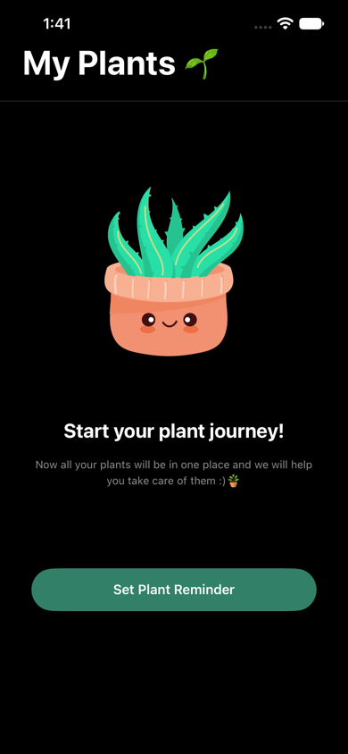
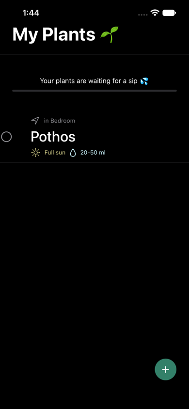
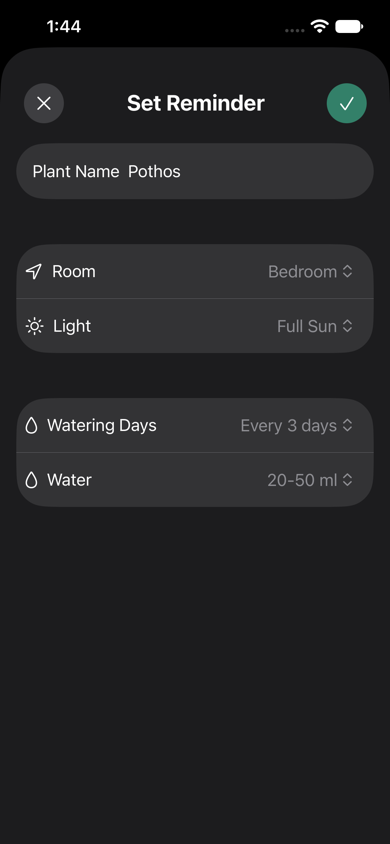
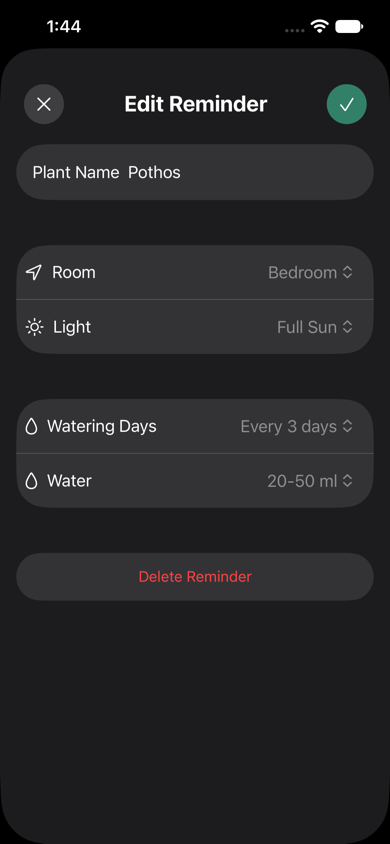
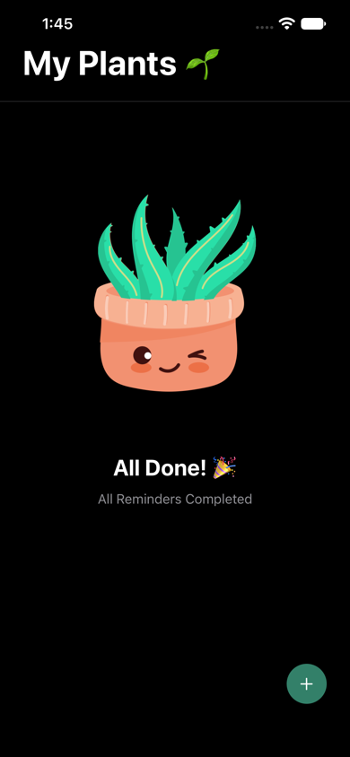

# Planto 🌱

**Planto** is a plant watering reminder app that helps users organize their plants, remember when to water them, and track their watering progress.

## Main Features

- **Add plant reminders:** Enter a plant's name and choose its room, light conditions, water amount, and watering frequency.
- **Repeating notifications:** Receive local watering reminders at the selected interval (every 1, 2, 3, 7, 10, or 14 days).
- **Track watering progress:** Mark plants as watered and view progress in a progress bar.
- **Automatic checkbox reset:** When Planto opens or becomes active, it resets checkboxes for overdue watering cycles.
- **Edit reminders:** Update plant details and watering frequency.
- **Delete reminders:** Confirm before deleting a plant and cancelling its pending notification.
- **Save plants locally:** Keep plant information between app launches.

## Technologies Used

- Swift and SwiftUI
- MVVM (Model–View–ViewModel) project organization
- UserNotifications for local reminders
- UserDefaults and Codable for saving plant information
- Xcode

## Getting Started

1. Open the project in Xcode.
2. Select an iPhone simulator or a connected iPhone.
3. Run the app and add your first plant reminder.
4. Allow notification permission to receive watering reminders.

## Screenshots

Captured from the running app on an iPhone 17e simulator using sample plant data.

| Welcome | Plant List |
| --- | --- |
|  |  |

| Add Reminder | Edit Reminder |
| --- | --- |
|  |  |

### All Done

